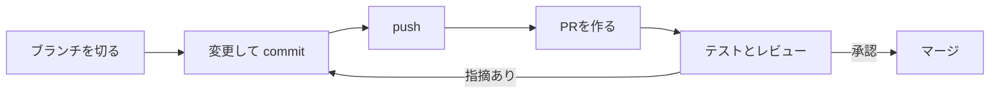

## GitHub とは

**GitHub** は、Git のリポジトリ（履歴を含むプロジェクト）をインターネット上で共有するサービスです。チームの開発では、GitHub 上のリポジトリを中心に作業します。

| 用語 | 意味 |
| --- | --- |
| リモートリポジトリ | GitHub 上にあるリポジトリ。`origin` という名前で呼ぶことが多い |
| `git clone` | リモートリポジトリを、自分のPCにコピーする |
| `git push` | 自分のPCの commit を、リモートリポジトリに送る |
| `git pull` | リモートリポジトリの新しい commit を、自分のPCに取り込む |

## プルリクエスト（PR）の流れ

チームの開発では、作業用のブランチで変更し、**プルリクエスト（PR）** を作って、ほかの人にレビューしてもらってから取り込みます。



```bash
git switch -c fix/free-shipping
# 編集して commit
git push -u origin fix/free-shipping   # 初めて push するブランチは -u を付ける
```

push すると、GitHub のリポジトリのページに「Compare & pull request」ボタンが出るので、そこから PR を作ります。

- PR を作ると、GitHub Actions などで **自動テスト** が実行されます。テストが失敗していたら、まず自分で直します
- レビューで **指摘（コメント）** をもらったら、同じブランチで直して commit・push します。PR に自動で追加されます
- 承認されたら **マージ**（取り込み）します

### PR の説明の書き方

PR の説明は、レビューする人が「何のための変更で、どこを見ればいいか」をすぐに分かるように書きます。

```markdown
## 概要
税込でちょうど5,000円の注文に送料がかかっていたので、送料無料の条件を「5,000円以上」に直しました。

## 変更内容
- 送料の判定を `>` から `>=` に変更
- ちょうど5,000円のときのテストを追加

## 確認したこと
- [x] すべてのテストが通る
- [x] 4,999円は550円、5,000円は0円になることを画面でも確認

## 関連
- チケット: #12
```

「修正しました」だけの説明では、レビューする人がコードをすべて読んで意図を推測しなければいけません。

### レビューへの対応

- 指摘には **すべて返信** する。直したら「直しました（commit のリンク）」、直さない場合は理由を書く
- 分からない指摘は、推測で直さずに質問する
- 指摘はコードに対するもので、あなた個人への評価ではありません。レビューはチームでよいコードを作るための仕組みです

## このアプリでの中級の課題の進め方

中級からは、課題ごとに次の流れで進めます（GitHub と連携する機能ができたら、課題のページから案内します）。

1. コースのテンプレートリポジトリ（例: `practice-ts-intermediate`）から、自分のアカウントにリポジトリを作る。**「Include all branches」にチェックを入れる**（課題の開始ブランチもコピーするため）
2. 自分のリポジトリを clone する
3. 課題の **開始ブランチ**（`start/07-order-filter` など）から、作業用のブランチを切る
4. 課題文（`TASK.md`）を読んで実装し、commit・push する
5. **開始ブランチに向けて** PR を作る。自動テストが実行され、結果がこのアプリに記録される

```bash
git switch start/07-order-filter
git switch -c work/07-order-filter
# 実装して commit
git push -u origin work/07-order-filter
# GitHub で、start/07-order-filter に向けて PR を作る
```

PR を作るときは、**向き先（base）のブランチ** が開始ブランチになっているかを必ず確認してください。`main` に向けて作ると、課題として判定されません。

> 練習用のチケットで実際に PR を出す課題は、GitHub 連携の機能ができたあとに追加します。

## やってみよう

1. GitHub で新しいリポジトリ（private）を作り、前のレッスンの `sakura-mart` を push する（GitHub の画面に表示される手順に従う）
2. ブランチを切って `README.md` を変更し、push して PR を作る
3. 上の例を参考に、PR の説明（概要・変更内容・確認したこと）を書く
4. 自分で PR を見直してからマージする
