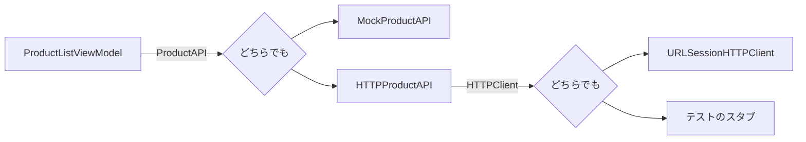

## Codable で JSON を型にする

API から届く JSON は、`Codable`（`Decodable` と `Encodable`）に準拠した型にそのまま変換できます。プロパティ名と JSON のキーが同じなら、変換のコードを書く必要はありません。

```swift
struct Product: Codable {
    let id: Int
    let name: String
    let price: Int
}

let json = #"{ "id": 1, "name": "国産こしひかり 5kg", "price": 2980 }"#
let product = try JSONDecoder().decode(Product.self, from: Data(json.utf8))
```

JSON が `{ "products": [...] }` のように包まれているときは、包みの形の型を作ります。その処理の中でしか使わない型は、`private` にして中に置きます。

```swift
private struct ProductsResponse: Decodable {
    let products: [Product]
}
```

- JSON のキーが `snake_case`（`unit_price`）なら、`decoder.keyDecodingStrategy = .convertFromSnakeCase`
- 型が違う（数値のはずが文字列）、キーがない、などのときは `DecodingError` が投げられる

## URLSession で通信する

```swift
let (data, response) = try await URLSession.shared.data(from: url)
let status = (response as? HTTPURLResponse)?.statusCode
```

`URLSession` は、**ステータスコードが 404 や 500 でも例外を投げません**。例外になるのは、通信そのものができなかったとき（圏外、タイムアウト）だけです。ステータスコードは自分で確かめます。

| 状況 | URLSession | 自分ですること |
| --- | --- | --- |
| 圏外、タイムアウト | `URLError` を投げる | 「通信できませんでした」 |
| 404 | 普通に返る | 「見つかりません」 |
| 500 | 普通に返る | 「サーバーでエラーが起きました」 |
| 200 で JSON の形が違う | 普通に返る | デコードで失敗 → 「データを読み込めませんでした」 |

これらを、アプリで扱いやすい **自分のエラー型**（`APIError`）に変えて投げると、画面は理由に合ったメッセージを出せます。

## 通信をプロトコルで抽象化する

API を使う処理の中で `URLSession.shared` を直接使うと、テストのたびに本物のサーバーにつながってしまい、「404 のとき」「通信できないとき」をテストできません。

そこで、**通信する部分をプロトコルにして、外から渡す**（依存性の注入）ようにします。

```swift
protocol HTTPClient: Sendable {
    func get(_ url: URL) async throws -> (Data, HTTPURLResponse)
}

struct HTTPProductAPI: ProductAPI {
    let baseURL: URL
    let client: HTTPClient   // 本物でも偽物でもよい

    func fetchProducts() async throws -> [Product] { ... client.get(...) ... }
}
```

- アプリでは `URLSessionHTTPClient`（本物）を渡す
- テストでは、決まったレスポンス（404、壊れた JSON など）を返す **スタブ** を渡す

さらに `HTTPProductAPI` 自体も `ProductAPI` プロトコルに準拠させておけば、画面（ViewModel）は **モックと本物を区別せずに** 使えます。開発中はアプリの中のモック、つながる環境では本物、と切り替えられます。



## Linux で URLSession を使う

`SakuraMartKit` は Linux でもテストします。Linux の Swift では `URLSession` が `FoundationNetworking` という別のモジュールにあるので、次のように書きます（iOS では何もしません）。

```swift
import Foundation
#if canImport(FoundationNetworking)
import FoundationNetworking
#endif
```
