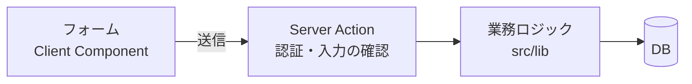

## 画面からデータを変更する流れ

画面からデータを変える処理は、次の3つに分けて作ると、それぞれをテストしやすく、ほかの場所からも使い回せます。



| 層 | 役割 | この課題では |
| --- | --- | --- |
| 業務ロジック | 業務のルールを守ってDBを変える。画面のことは知らない | `changeOrderStatus` |
| Server Action | ログインと入力を確かめ、業務ロジックを呼び、結果を画面向けの形にする | `updateOrderStatus` |
| フォーム | 入力、送信中の表示、結果の表示 | `OrderStatusForm` |

## 業務のルールはサーバーで守る

「発送済の注文は受付に戻せない」のようなルールは、**画面で選べなくするだけでは不十分** です。画面は改造できるので、サーバー側（業務ロジック）でも必ず確かめます。画面で選択肢を絞るのは「使いやすさ」のため、サーバーのチェックは「正しさ」のためです。

ステータスの順番のように **表で書けるルール** は、`if` を並べるより、データ（オブジェクト）で表すと読みやすく、変更もしやすくなります。

```ts
const ORDER_STATUS_TRANSITIONS: Record<OrderStatus, readonly OrderStatus[]> = {
  pending: ["paid", "cancelled"],
  paid: ["shipped", "cancelled"],
  // ...
};
```

関係する複数の変更（ステータスの変更と、ポイントの取り消し）は、**トランザクション** の中で行います。途中で失敗したら全部が取り消されるので、「ステータスだけ変わってポイントが戻らない」状態になりません。

## Server Actions

**Server Action** は、`"use server"` を付けた、サーバーで動く関数です。フォームの `action` に渡すと、送信したときにサーバーで実行されます。API（Route Handler）を自分で作らなくても、画面からサーバーの処理を呼べます。

```ts
"use server";

export async function updateOrderStatus(orderId: number, _prev: State, formData: FormData): Promise<State> {
  if (!(await auth())) return { error: "ログインし直してください" };
  const status = formData.get("status");
  // ...確かめて、業務ロジックを呼ぶ
  revalidatePath(`/admin/orders/${orderId}`); // ページを最新のデータで描き直す
  return { ok: "変更しました" };
}
```

Server Action も、ブラウザから直接呼び出せる **公開されたAPIと同じ** です。ログインの確認と、入力の確認を必ず行います。

## 送信中・成功・エラーを表示する

`useActionState` を使うと、Server Action の **戻り値（状態）** と **送信中かどうか** を受け取れます。

```tsx
"use client";

export function OrderStatusForm({ orderId, status }: Props) {
  const [state, action, pending] = useActionState(updateOrderStatus.bind(null, orderId), null);
  return (
    <form action={action}>
      {/* ... */}
      <Button disabled={pending}>{pending ? "変更中…" : "変更する"}</Button>
      {state?.error && <p role="alert">{state.error}</p>}
    </form>
  );
}
```

- **送信中**: ボタンを押せなくする（二重送信を防ぐ）。何が起きているかを文言で伝える
- **エラー**: 何が起きたか、どうすればいいかを表示する。`role="alert"` を付けると、読み上げソフトにも伝わる
- **成功**: 変わったことが分かるように表示する

`.bind(null, orderId)` で、フォームの値以外に必要な引数（注文ID）を先に渡しておけます。

## Client Component のテスト

フォームのテストでは、Server Action をモック（`vi.mock`）にして、「送信したら正しい引数で呼ぶか」「戻り値に応じて正しく表示するか」を確かめます。サーバーの処理（業務ロジック）は、別のテストで確かめます。
