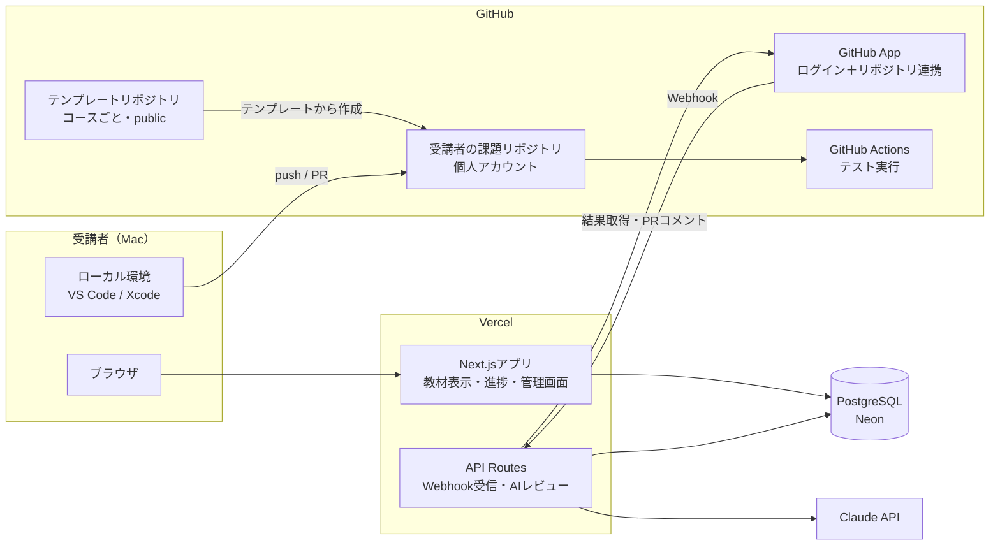
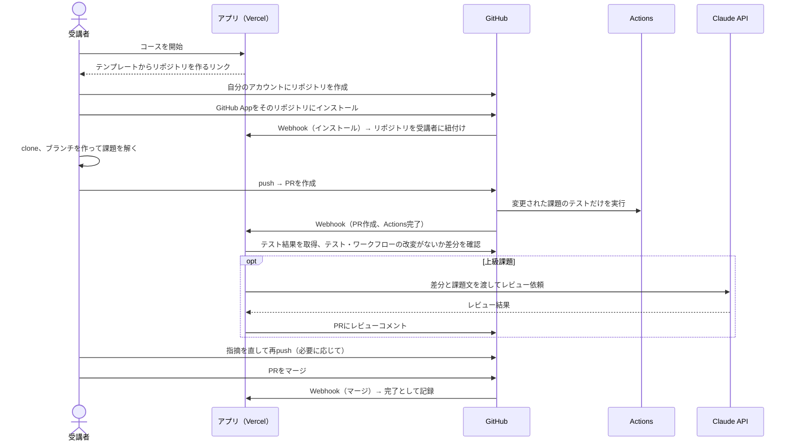

# 全体設計

> ステータス: 設計案（未決事項は「8. 未決事項」に記載）
> 最終更新: 2026-10-19
> 前提: [requirements.md](requirements.md)

## 1. 方針

- **初級はブラウザ内で完結** させる（Swiftを除く）。初学者が環境構築でつまずかないようにするため
- **中級・上級は実務と同じ流れ** で学ぶ。ローカルで解き、GitHubにPRを出し、GitHub Actionsのテストで判定する
- コード実行サーバーは持たない。アプリはVercelとDB、GitHubだけで動かす
- 受講者全員がMacを持っている前提とする

## 2. レベル × 言語ごとの学習方式

| | 初級 | 中級 | 上級 |
| --- | --- | --- | --- |
| JavaScript / TypeScript | ブラウザ内で実行（エディタ＋自動判定） | ローカル（Node.js＋Vitest）→ PR → Actionsでテスト | ローカル → PR → テスト＋AIレビュー |
| Ruby / Rails | ブラウザ内で実行（ruby.wasm、Rubyの文法） | ローカル（Ruby、Railsの基礎）→ PR → Actionsでテスト | ローカル（Railsの設計）→ PR → テスト＋AIレビュー |
| Swift | Xcode（Playground）で解き、アプリ上のクイズで理解を確認 | ローカル（Swift Package）→ PR → Linuxランナーでテスト | ローカル → PR → テスト＋AIレビュー |

- **初級の最後** に、全言語共通で「環境構築」と「Git／GitHub／PRの出し方」のレッスンを置く。中級のPR提出に入るための準備にあたる
- **iOS固有の課題（SwiftUIなど）**: ロジック（ViewModelなど）はSwift Packageに分けてLinuxランナーでテストする。画面部分はAIレビューのみで判定する。ロジックと画面を分けて設計する習慣も身につける狙い

## 3. システム構成



### 3.1 構成要素

| 要素 | 内容 |
| --- | --- |
| アプリ | Next.js（App Router）＋ TypeScript。Vercelにデプロイ |
| 認証 | Auth.js（GitHubプロバイダー）。ログインには後述のGitHub AppのOAuth機能を使い、ログインとリポジトリ連携を1つのAppにまとめる |
| DB | PostgreSQL（Vercel Marketplace経由のNeon）＋ Drizzle ORM |
| 教材 | このリポジトリの `content/` 配下にMarkdownとYAMLで置く。ビルド時に読み込む |
| ブラウザ内実行 | Monacoエディタ。JS/TSはWeb Workerで実行し、TSはブラウザ内で変換する（sucraseなど）。Rubyは ruby.wasm をWeb Workerで実行する。どちらも制限時間を過ぎたらWorkerごと停止する |
| GitHub App | 受講者が自分の課題リポジトリにインストールする。PRとActionsの結果をWebhookで受け取り、PRにコメントを書く |
| テンプレートリポジトリ | コースごとに1つ（例: `practice-ts-intermediate`）。publicにする。課題のひな形、テスト、Actionsのワークフローを含む |
| AIレビュー | Vercel側からClaude APIを呼ぶ。APIキーはVercelの環境変数だけに置き、受講者のリポジトリには置かない |

## 4. 主な流れ

### 4.1 初級（ブラウザ内）

1. レッスン本文を読む
2. エディタでコードを書き、「実行」で出力を確認する
3. 「提出」で課題のテストケースをブラウザ内で実行する
4. すべて通ったら合格になり、結果をAPIに送って進捗に記録する

※ 判定がブラウザ内で行われるため、結果は改ざんできる。初級は自己学習が目的なので、これは許容する。

### 4.2 Swift初級（Xcode＋クイズ）

1. 最初のレッスンでXcodeをインストールする
2. アプリからPlaygroundファイル（zip）をダウンロードし、Xcodeで解く。Playground内のチェック用コードで、自分で答え合わせをする
3. アプリ上で理解度チェックのクイズに答え、合格すると完了になる

### 4.3 中級・上級（ローカル＋PR）



#### 完了条件

- 中級: PRのテストがすべて通った状態でマージされたら完了
- 上級: テストが通り、AIレビューを受けたあとにマージされたら完了（AIレビューは合否ではなく助言として扱う）

#### 不正対策

受講者のリポジトリなので、テストやワークフローは書き換えられてしまう。そこで、アプリ側でPRの差分を確認し、`tests/` や `.github/` を変更したPRは判定対象外にする。社内の学習用途なので、これ以上の対策はしない。

#### 課題リポジトリの単位

受講者 × コースで1リポジトリとする（例: `taitai03/practice-ts-intermediate`）。課題ごとにディレクトリを分け、1課題 ＝ 1ブランチ ＝ 1PR で進める。

```
practice-ts-intermediate/
├── .github/workflows/test.yml   # 変更された課題のディレクトリだけテストする
├── 01-array-methods/
│   ├── README.md                # 課題文へのリンク
│   ├── src/index.ts             # 受講者が編集する
│   └── tests/index.test.ts
└── 02-async-await/
    └── ...
```

#### GitHub Actionsの実行時間

課題リポジトリは受講者の個人アカウントにあるので、Actionsの利用時間は各受講者の枠を使う。publicリポジトリなら無料で無制限、privateリポジトリでもFreeプランの月の無料枠内で収まる想定。macOSランナーは使わない（Swiftも `swift` のDockerイメージを使ってLinuxで動かす）。

## 5. 教材の構成（このリポジトリ）

```
content/
├── typescript/
│   ├── beginner/
│   │   └── 01-variables/
│   │       ├── lesson.md        # 本文（frontmatterにタイトル・順番・所要時間）
│   │       └── exercise.yaml    # ブラウザ内課題: 初期コード、テストケース、ヒント
│   ├── intermediate/
│   │   └── 01-array-methods/
│   │       ├── lesson.md
│   │       └── task.yaml        # PR課題: テンプレート内のディレクトリ名、完了条件
│   └── advanced/
├── ruby/
└── swift/
    └── beginner/
        └── 01-hello-playground/
            ├── lesson.md
            ├── playground.zip   # ダウンロード用
            └── quiz.yaml
```

- テンプレートリポジトリは、MVPではそれぞれ別リポジトリとして手作業で管理する。`task.yaml` からディレクトリ名で参照する
- 将来は、このリポジトリの `templates/` を正として、テンプレートリポジトリへ自動で同期する仕組みも検討する

## 6. データモデル（PostgreSQL）

| テーブル | 主なカラム | 用途 |
| --- | --- | --- |
| `users` | id, github_id, github_login, name, avatar_url, role（learner / mentor / admin）, created_at | 受講者・管理者 |
| `course_repos` | id, user_id, course_id, repo_full_name, installation_id, created_at | 受講者のコースとGitHubリポジトリの紐付け |
| `progress` | user_id, lesson_id, status（not_started / in_progress / completed）, completed_at | レッスンごとの進捗 |
| `submissions` | id, user_id, lesson_id, kind（browser / quiz / pull_request）, pr_number, head_sha, status（pending / passed / failed / invalid）, test_summary（jsonb）, created_at | 提出と判定結果の履歴 |
| `ai_reviews` | id, submission_id, model, body, input_tokens, output_tokens, created_at | AIレビュー結果と使用量（費用管理用） |

- `course_id` と `lesson_id` は `content/` のパスから作る文字列ID（例: `typescript/intermediate/01-array-methods`）。教材はDBに入れない
- 初級で提出したコードの全文は保存しない。中級以上のコードはGitHub上に残るため、DBにはPR番号とコミットだけを持つ

## 7. 実装上の注意

- GitHubのWebhookは10秒以内に応答する必要がある。AIレビューのような時間のかかる処理は、Webhookを受け取ったらすぐ応答し、そのあとで実行する（Vercelの `waitUntil` やキューを使う）
- Webhookは署名を検証する。同じイベントが重複して届いてもよいように、処理は `head_sha` 単位で冪等にする
- AIレビューは、受講者ごと・日ごとの回数上限を設けて費用を抑える
- 受講者がテンプレートからリポジトリを作る手順や、GitHub Appで個人アカウントのリポジトリをどこまで自動で作れるかは、実装前にGitHubのAPI仕様を確認する。自動化できない部分は手順を案内する

## 8. 未決事項

- [ ] 社内メンバーだけに限定する方法（管理者が登録したGitHubユーザー名のみ許可／会社のGitHub Organizationのメンバーかどうかで判定）
- [ ] 課題リポジトリをpublicにするかprivateにするか（publicなら他の受講者の解答が見えてしまう）
- [ ] レベルの決め方（本人が選ぶ／レベル判定テスト）
- [ ] メンター・管理者向けに、受講者の進捗一覧画面を作るか
- [ ] Claude APIの費用を誰が負担するか、APIキーの管理者、使うモデル
- [ ] 各コースのカリキュラム（レッスンの一覧と数）と、初期の教材を誰が書くか
