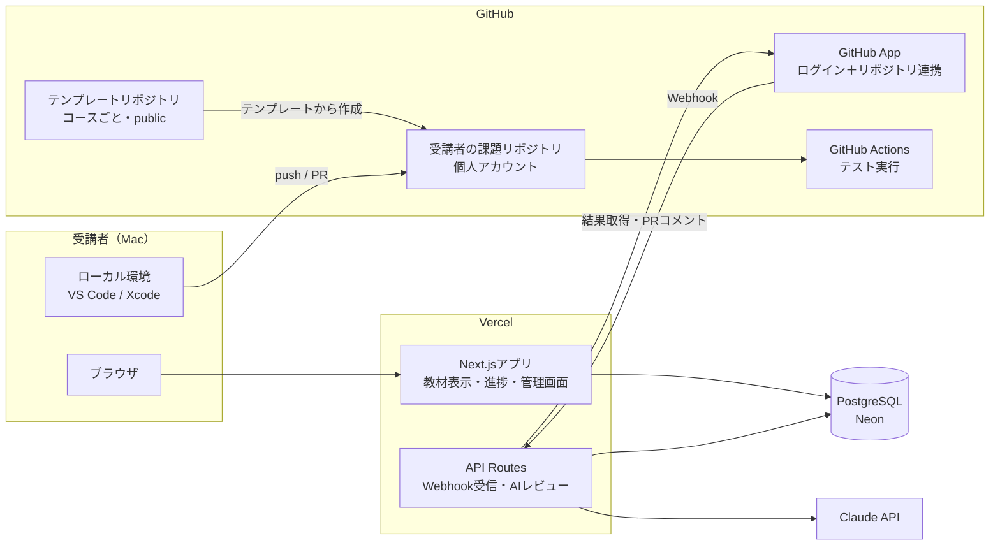
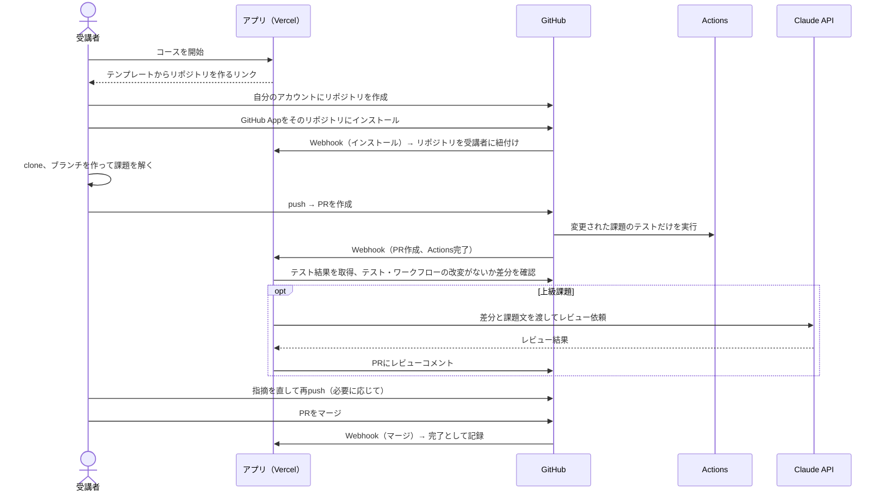

# 全体設計

> ステータス: 設計案（未決事項は「9. 未決事項」に記載）
> 最終更新: 2026-10-19
> 前提: [requirements.md](requirements.md)

## 1. 方針

- **初級はブラウザ内で完結** させる（Swiftを除く）。初学者が環境構築でつまずかないようにするため
- **中級・上級は実務と同じ流れ** で学ぶ。ローカルで解き、GitHubにPRを出し、GitHub Actionsのテストで判定する
- コード実行サーバーは持たない。アプリはVercelとDB、GitHubだけで動かす
- 受講者全員がMacを持っている前提とする

## 2. レベル × 言語ごとの学習方式

| | 初級 | 中級 | 上級 |
| --- | --- | --- | --- |
| JavaScript / TypeScript | ブラウザ内で実行（エディタ＋自動判定） | ローカル（Node.js＋Vitest）→ PR → Actionsでテスト | ローカル → PR → テスト＋AIレビュー |
| Ruby / Rails | ブラウザ内で実行（ruby.wasm、Rubyの文法） | ローカル（Ruby、Railsの基礎）→ PR → Actionsでテスト | ローカル（Railsの設計）→ PR → テスト＋AIレビュー |
| Swift | Xcode（Playground）で解き、アプリ上のクイズで理解を確認 | ローカル（Swift Package）→ PR → Linuxランナーでテスト | ローカル → PR → テスト＋AIレビュー |

- **初級の最後** に、全言語共通で「環境構築」と「Git／GitHub／PRの出し方」のレッスンを置く。中級のPR提出に入るための準備にあたる
- **iOS固有の課題（SwiftUIなど）**: ロジック（ViewModelなど）はSwift Packageに分けてLinuxランナーでテストする。画面部分はAIレビューのみで判定する。ロジックと画面を分けて設計する習慣も身につける狙い

## 3. システム構成



### 3.1 構成要素

| 要素 | 内容 |
| --- | --- |
| アプリ | Next.js（App Router）＋ TypeScript。Vercelにデプロイ |
| 認証 | Auth.js（GitHubプロバイダー）。ログインには後述のGitHub AppのOAuth機能を使い、ログインとリポジトリ連携を1つのAppにまとめる |
| DB | PostgreSQL（Vercel Marketplace経由のNeon）＋ Drizzle ORM |
| 教材 | このリポジトリの `content/` 配下にMarkdownとYAMLで置く。ビルド時に読み込む |
| ブラウザ内実行 | Monacoエディタ。JS/TSはWeb Workerで実行し、TSはブラウザ内で変換する（sucraseなど）。Rubyは ruby.wasm をWeb Workerで実行する。どちらも制限時間を過ぎたらWorkerごと停止する |
| GitHub App | 受講者が自分の課題リポジトリにインストールする。PRとActionsの結果をWebhookで受け取り、PRにコメントを書く |
| テンプレートリポジトリ | コースごとに1つ（例: `practice-ts-intermediate`）。publicにする。課題のひな形、テスト、Actionsのワークフローを含む |
| AIレビュー | Vercel側からClaude APIを呼ぶ。APIキーはVercelの環境変数だけに置き、受講者のリポジトリには置かない |

## 4. 主な流れ

### 4.1 初級（ブラウザ内）

1. レッスン本文を読む
2. エディタでコードを書き、「実行」で出力を確認する
3. 「提出」で課題のテストケースをブラウザ内で実行する
4. すべて通ったら合格になり、結果をAPIに送って進捗に記録する

※ 判定がブラウザ内で行われるため、結果は改ざんできる。初級は自己学習が目的なので、これは許容する。

### 4.2 Swift初級（Xcode＋クイズ）

1. 最初のレッスンでXcodeをインストールする
2. アプリからPlaygroundファイル（zip）をダウンロードし、Xcodeで解く。Playground内のチェック用コードで、自分で答え合わせをする
3. アプリ上で理解度チェックのクイズに答え、合格すると完了になる

### 4.3 中級・上級（ローカル＋PR）



#### 完了条件

- 中級: PRのテストがすべて通った状態でマージされたら完了
- 上級: テストが通り、AIレビューを受けたあとにマージされたら完了（AIレビューは合否ではなく助言として扱う）

#### 不正対策

受講者のリポジトリなので、テストやワークフローは書き換えられてしまう。そこで、アプリ側でPRの差分を確認し、`tests/` や `.github/` を変更したPRは判定対象外にする。社内の学習用途なので、これ以上の対策はしない。

#### 課題リポジトリの単位

受講者 × コースで1リポジトリとする（例: `taitai03/practice-ts-intermediate`）。課題ごとにディレクトリを分け、1課題 ＝ 1ブランチ ＝ 1PR で進める。

```
practice-ts-intermediate/
├── .github/workflows/test.yml   # 変更された課題のディレクトリだけテストする
├── 01-array-methods/
│   ├── README.md                # 課題文へのリンク
│   ├── src/index.ts             # 受講者が編集する
│   └── tests/index.test.ts
└── 02-async-await/
    └── ...
```

#### GitHub Actionsの実行時間

課題リポジトリは受講者の個人アカウントにあるので、Actionsの利用時間は各受講者の枠を使う。publicリポジトリなら無料で無制限、privateリポジトリでもFreeプランの月の無料枠内で収まる想定。macOSランナーは使わない（Swiftも `swift` のDockerイメージを使ってLinuxで動かす）。

## 5. 教材の構成（このリポジトリ）

```
content/
├── typescript/
│   ├── beginner/
│   │   └── 01-variables/
│   │       ├── lesson.md        # 本文（frontmatterにタイトル・順番・所要時間）
│   │       └── exercise.yaml    # ブラウザ内課題: 初期コード、テストケース、ヒント
│   ├── intermediate/
│   │   └── 01-array-methods/
│   │       ├── lesson.md
│   │       └── task.yaml        # PR課題: テンプレート内のディレクトリ名、完了条件
│   └── advanced/
├── ruby/
└── swift/
    └── beginner/
        └── 01-hello-playground/
            ├── lesson.md
            ├── playground.zip   # ダウンロード用
            └── quiz.yaml
```

- テンプレートリポジトリは、MVPではそれぞれ別リポジトリとして手作業で管理する。`task.yaml` からディレクトリ名で参照する
- 将来は、このリポジトリの `templates/` を正として、テンプレートリポジトリへ自動で同期する仕組みも検討する

## 6. データモデル（PostgreSQL）

| テーブル | 主なカラム | 用途 |
| --- | --- | --- |
| `users` | id, github_id, github_login, name, avatar_url, role（learner / mentor / admin）, created_at | 受講者・管理者 |
| `allowed_users` | github_login, role, invited_by, created_at | ログインを許可するGitHubユーザー（許可リスト） |
| `course_repos` | id, user_id, course_id, repo_full_name, installation_id, created_at | 受講者のコースとGitHubリポジトリの紐付け |
| `progress` | user_id, lesson_id, status（not_started / in_progress / completed）, completed_at | レッスンごとの進捗 |
| `submissions` | id, user_id, lesson_id, kind（browser / quiz / pull_request）, pr_number, head_sha, status（pending / passed / failed / invalid）, test_summary（jsonb）, created_at | 提出と判定結果の履歴 |
| `badges` | id, user_id, course_id, awarded_at | コース修了バッジ |
| `ai_reviews` | id, submission_id, model, body, input_tokens, output_tokens, created_at | AIレビュー結果と使用量（費用管理用） |

- `course_id` と `lesson_id` は `content/` のパスから作る文字列ID（例: `typescript/intermediate/01-array-methods`）。教材はDBに入れない
- 学習の足あとやランキングは `progress` と `submissions` から集計する。専用のテーブルは作らない
- 初級で提出したコードの全文は保存しない。中級以上のコードはGitHub上に残るため、DBにはPR番号とコミットだけを持つ

## 7. 実装上の注意

- GitHubのWebhookは10秒以内に応答する必要がある。AIレビューのような時間のかかる処理は、Webhookを受け取ったらすぐ応答し、そのあとで実行する（Vercelの `waitUntil` やキューを使う）
- Webhookは署名を検証する。同じイベントが重複して届いてもよいように、処理は `head_sha` 単位で冪等にする
- AIレビューは、受講者ごと・日ごとの回数上限を設けて費用を抑える
- 受講者がテンプレートからリポジトリを作る手順や、GitHub Appで個人アカウントのリポジトリをどこまで自動で作れるかは、実装前にGitHubのAPI仕様を確認する。自動化できない部分は手順を案内する

## 8. 運用まわりの決定事項

### 8.1 ログインできる人の制限（許可リスト方式）

- 管理者が管理画面でGitHubユーザー名を登録し、登録された人だけがログインできる
- 未登録の人がログインしようとした場合は「管理者に登録を依頼してください」と表示する
- `allowed_users` テーブル（github_login, role, invited_by, created_at）を追加する。初回ログイン時に `users` と紐付ける
- 最初の管理者は環境変数（`INITIAL_ADMIN_GITHUB_LOGIN`）で指定する

### 8.2 課題リポジトリは private

- テンプレートから作るときの案内でprivateを指定してもらう
- アプリ側では、GitHub Appがインストールされたリポジトリがpublicなら警告を出す（判定はブロックしない）
- Actionsは各受講者の無料枠を使う。Linuxランナーで課題ディレクトリ単位のテストなら、1回あたり数分以内に収まる想定

### 8.3 レベルは本人が選ぶ

- どのコースからでも始められる
- 各コースの入口に「このレベルの前提」チェックリスト（5項目程度）を置く。すべて自信を持ってチェックできれば、そのコースから始める目安になる
- チェックリストは `content/<言語>/<レベル>/README.md` に書き、記録はしない

### 8.4 メンター・管理者向け画面

| 画面 | 内容 | 使える人 |
| --- | --- | --- |
| 受講者一覧 | 受講者ごとのコース別の進捗率、最終活動日 | mentor, admin |
| 受講者の詳細 | レッスンごとの状態、提出履歴 | mentor, admin |
| 提出の詳細 | PRの差分、テスト結果、AIレビューをアプリ上で表示（GitHub App経由で取得）。受講者のprivateリポジトリに招待されていなくても見られる | mentor, admin |
| ユーザー管理 | 許可リストの登録・削除、ロール（learner / mentor / admin）の変更 | admin |

- 差分はDBに保存せず、表示のたびにGitHub APIから取得する（短時間キャッシュする）

### 8.5 AIレビュー（Claude API）

- 当面は開発者個人のAPIキーで始め、本格運用の前に会社のキーへ切り替える。キーはVercelの環境変数 `ANTHROPIC_API_KEY` だけに置くので、切り替えは環境変数の変更だけで済む
- 個人のキーで費用を抑えるため、次の上限を設ける（値は環境変数で変更できるようにする）
  - 受講者1人あたり1日の回数上限
  - 全体の1か月の回数上限。超えたらAIレビューを止め、PRに「上限に達した」とコメントする
  - Anthropic Consoleの利用上限も設定しておく
- `ai_reviews` に使用トークン数を記録し、管理画面で月ごとの合計を確認できるようにする
- 使うモデルは実装時に決める
- 上級の演習の種類ごとに、レビューの観点（設計、セキュリティ、レビュー指摘の質など）をプロンプトとして `task.yaml` に持たせる

### 8.6 教材とカリキュラム

- 各コースのレッスン数は **MVPでは5〜8本**（3言語 × 3レベルで約45〜70本）
- 教材はClaudeが下書きを作り、各言語に詳しい社内メンバーがPRでレビュー・修正する
- 進め方
  1. コースごとのカリキュラム（レッスンの一覧、学ぶこと、課題の概要）を `docs/curriculum.md` にまとめて合意する
  2. レッスン本文と課題を、コース単位でPRにして作る
- 注意: 下書きは実際に動かして確認してから出すが、内容の最終的な正しさは社内レビューで担保する

## 9. 未決事項

- [ ] 各コースのカリキュラムの中身（`docs/curriculum.md` で合意する）
- [ ] AIレビューに使うモデルと、回数上限の具体的な値
- [ ] 会社のAPIキーに切り替える時期と、その費用負担の承認
- [ ] Vercelの無料プラン（Hobby、個人・非商用のみ）で社内研修に使ってよいか。だめな場合はProプランか別のデプロイ先
