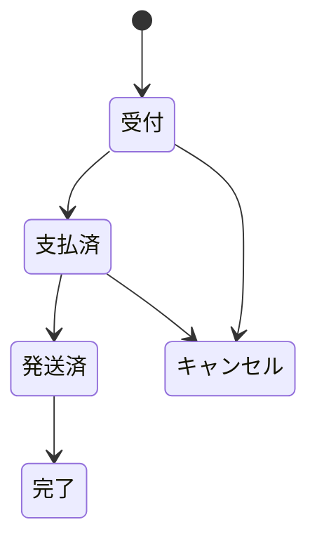

# サンプルアプリ「さくらマート」仕様

> ステータス: 案
> 最終更新: 2026-10-19
> 前提: [curriculum.md](curriculum.md)、[architecture.md](architecture.md)

架空のECショップ「さくらマート」は、全コースで共通の題材にする。中級以降の課題は、言語ごとに用意したさくらマートのアプリに対する機能追加・バグ修正・改善として出す。

## 1. 方針

- **3言語で同じ業務仕様を使う**: 商品、注文、料金計算のルールは言語をまたいで共通にする。初級の演習（送料計算、割引など）もこのルールに合わせる
- **お手本になるコードにする**: 中級のアプリは、受講者が「現場のコードはこう書く」と真似してよい品質で作る。テストも付ける
- **受講者が作る機能は入れておかない**: 課題で受講者が追加する機能（在庫管理、絞り込みなど）は、ベースのアプリには入れない
- **全体を1〜2時間で読める規模に抑える**: 業務アプリらしさは残しつつ、機能を必要な分に絞る。目安は1アプリあたり3,000〜5,000行
- **上級の「問題のあるコード」は課題の開始ブランチにだけ入れる**: ベースのアプリはきれいなまま保つ

## 2. 言語ごとのアプリ

| | Next.js版 | Rails版 | iOS版 |
| --- | --- | --- | --- |
| 使うコース | JS/TS 中級・上級 | Ruby/Rails 中級・上級 | Swift 中級・上級 |
| 利用者 | スタッフ（管理画面）＋会員（API） | スタッフ（管理画面）＋会員（API） | 会員（アプリ） |
| 画面 | 管理画面のみ | 管理画面のみ | 会員向けアプリ |
| 構成 | Next.js（App Router）、TypeScript、Drizzle、Auth.js（スタッフのログイン）、shadcn/ui ＋ Tailwind CSS | Rails 8、Hotwire（ERB）、Rails標準の認証、RSpec | SwiftUI、iOS 17以上、ロジックは Swift Package（`SakuraMartKit`） |
| DB | 中級: SQLite／上級: PostgreSQL | 中級: SQLite／上級: PostgreSQL | なし（端末内の保存のみ） |
| 外部API | 決済・配送のAPIはモック | 決済・配送のAPIはモック | 普段はアプリ内のモックAPI。設定でNext.js版のAPIにも接続できる |
| テスト | Vitest、React Testing Library | RSpec（モデル、リクエスト）、FactoryBot | Swift Testing（`SakuraMartKit` をLinuxでテスト。Actions は `swift:6.2` のコンテナで実行） |

- 上級ではPostgreSQLを Docker Compose で起動する。ロックやインデックスなど、本番と同じ動きが必要な課題があるため
- iOS版のViewModelはSwift Packageに置き、SwiftUIとCombineに依存させない。Linuxでテストするため（Observationフレームワークを使う場合は、Linuxでビルドできるか実装前に確認する）

## 3. 業務仕様（3言語で共通）

### 3.1 データ

| データ | 主な項目 | 備考 |
| --- | --- | --- |
| カテゴリ | 名前 | 6種類（食品、飲料、日用品、キッチン用品、文具、ギフト） |
| 商品 | 名前、説明、価格（税抜・円）、カテゴリ、公開状態（公開／非公開）、在庫数 | 在庫数はRails版と上級版のみ。Next.js中級版では総まとめの課題で受講者が追加する |
| 会員 | 名前、メールアドレス、会員ランク（一般／シルバー／ゴールド）、ポイント残高 | |
| 注文 | 会員、ステータス、小計、割引額、送料、合計、使ったクーポン、注文日時 | |
| 注文明細 | 注文、商品、数量、購入時の単価 | 単価は注文時点の価格を保存する |
| クーポン | コード、割引の種類（定額／定率）、割引の値、最低購入金額、有効期間 | 1注文につき1枚 |
| スタッフ | 名前、メールアドレス、権限（管理者／一般） | 管理画面にログインする人 |

### 3.2 注文ステータス



- 売上の集計には、キャンセルの注文を含めない
- 発送済み以降はキャンセルできない

### 3.3 料金計算のルール

計算は次の順番で行う。端数はすべて切り捨てる。

1. **小計**: 商品の価格（税抜）× 数量 の合計
2. **会員ランク割引**: 一般 0%、シルバー 5%、ゴールド 10%
3. **クーポン割引**: ランク割引のあとの金額に適用する。最低購入金額は、ランク割引のあとの金額で判定する
4. **消費税**: 割引後の金額に10%を加える
5. **送料**: 550円（税込）。消費税を加えた金額が5,000円以上なら無料
6. **合計**: 4 ＋ 5

**ポイント**: 4の金額（送料を含まない税込金額）の1%を付与する。ゴールド会員は2%。

## 4. 機能の範囲

課題で受講者が作る機能は「受講者が作る」と記載し、ベースのアプリには入れない。

### 4.1 Next.js版（中級）

| 区分 | 機能 | 状態 |
| --- | --- | --- |
| 管理画面 | スタッフのログイン・ログアウト | ベースにある |
| 管理画面 | 商品一覧・詳細・編集 | ベースにある |
| 管理画面 | 商品一覧のキーワード検索・カテゴリ絞り込み | 受講者が作る（中級6） |
| 管理画面 | 注文一覧・詳細 | ベースにある |
| 管理画面 | 注文ステータスの変更 | 受講者が作る（中級8） |
| 管理画面 | 会員一覧 | ベースにある |
| 管理画面 | 在庫管理（一覧、入荷登録、在庫不足のアラート） | 受講者が作る（中級10） |
| 会員向けAPI | 商品一覧・詳細、注文の作成、自分の注文履歴、会員登録 | ベースにある |
| API | 注文一覧APIの期間・ステータス絞り込み | 受講者が作る（中級7） |
| API | 会員登録APIの入力チェック | 受講者が作る（中級5） |
| ロジック | 料金計算、ポイント計算、クーポンの適用 | ベースにある |
| ロジック | 決済APIのレスポンスの型付け、配送APIからの追跡状況の取得 | 受講者が作る（中級2、3） |
| スクリプト | 月別・商品別の売上CSVの出力 | 受講者が作る（中級1） |

### 4.2 Rails版（中級）

| 区分 | 機能 | 状態 |
| --- | --- | --- |
| 管理画面 | スタッフのログイン・ログアウト | ベースにある |
| 管理画面 | 商品一覧 | ベースにある |
| 管理画面 | 商品詳細ページ | 受講者が作る（中級4） |
| 管理画面 | 商品レビュー | 受講者が作る（中級5） |
| 管理画面 | 商品の登録・編集・非公開化 | 受講者が作る（中級6） |
| 管理画面 | 注文一覧・詳細、売上ダッシュボード | ベースにある |
| 管理画面 | 注文一覧の絞り込み、注文のJSON API | 受講者が作る（中級8） |
| 管理画面 | 社内備品の貸出管理 | 受講者が作る（中級9） |
| 会員向けAPI | 商品一覧・詳細、注文の作成、自分の注文履歴 | ベースにある |
| ロジック | 料金計算、ポイント計算、在庫の引き当て | ベースにある |
| スクリプト | 月別・商品別の売上CSVの出力 | 受講者が作る（中級1） |

### 4.3 iOS版（中級）

| 区分 | 機能 | 状態 |
| --- | --- | --- |
| 画面 | 商品一覧・詳細 | ベースにある |
| 画面 | 商品一覧のカテゴリ絞り込み | 受講者が作る（中級7） |
| 画面 | カート（数量変更、合計金額の表示） | ベースにある |
| 画面 | お気に入り | ベースにある |
| 画面 | 注文履歴（一覧、詳細） | 受講者が作る（中級9） |
| ロジック | 料金計算 | ベースにある |
| ロジック | 支払い方法ごとの手数料、入力チェック、注文履歴の集計 | 受講者が作る（中級1〜3） |
| 通信 | APIクライアント（モックと実APIの切り替え） | ベースにある |
| 通信 | 商品一覧と在庫情報の並列取得 | 受講者が作る（中級5） |

### 4.4 上級版（3言語共通の考え方）

- 中級版に、中級で受講者が作る機能（在庫管理など）を足した状態を上級版のベースにする
- DBをPostgreSQLに切り替え、データ量を増やす
- Rails版はスタッフの権限（管理者／一般）、バックグラウンドジョブ（Solid Queue）を使えるようにしておく
- 各課題の「問題のあるコード」（巨大な関数、脆弱性、N+1など）は、課題の開始ブランチで入れる

## 5. 初期データ

| データ | 中級 | 上級 |
| --- | --- | --- |
| 商品 | 50件 | 500件 |
| 会員 | 200人 | 5,000人 |
| 注文 | 2,000件（過去6か月分） | 50,000件（過去2年分） |
| クーポン | 5件 | 20件 |
| スタッフ | 管理者1人、一般2人 | 管理者1人、一般2人 |

- 上級は、N+1などの性能の問題が体感できるようにデータを多くする
- 初期データは毎回同じ内容になるように作る（テストやバグ再現のため）

## 6. 課題の開始ブランチ

### 6.1 仕組み

課題ごとに、テンプレートリポジトリに開始ブランチを用意する。受講者は開始ブランチから作業ブランチを切り、開始ブランチに向けてPRを出す。前の課題の出来に左右されずに、どの課題からでも始められる。

```
practice-ts-intermediate（テンプレート）
├── main                         # ベースのアプリ
├── start/01-sales-csv           # main ＋ 課題1の準備（課題文、テスト）
├── start/07-order-filter        # main ＋ 課題7の準備
├── start/09-coupon-bug          # main ＋ 課題9の準備（クーポンが二重に適用されるバグを入れたもの）
└── ...
```

受講者の作業の流れ:

```bash
git switch start/07-order-filter
git switch -c work/07-order-filter
# 実装してcommit
git push -u origin work/07-order-filter
# start/07-order-filter に向けてPRを作成
```

- テンプレートからリポジトリを作るときは「Include all branches」にチェックを入れてもらう（入れないと開始ブランチがコピーされない）
- GitHub Actions は、`start/` で始まるブランチに向けたPRでテストを実行する
- アプリ側は、PRの向き先のブランチ名から課題を判断する
- テストやワークフローの改変チェックは、開始ブランチとの差分で行う
- 各開始ブランチには、課題文（`TASK.md`）と受け入れ条件に対応するテストを入れる

### 6.2 開始ブランチの管理

ベースのアプリを直すたびに全ての開始ブランチを手で直すのは大変なので、次のように管理する。

- 開始ブランチは「main ＋ 課題ごとの差分」として、差分を `tasks/<課題>/` に置く
- スクリプトで、main に差分を当てて開始ブランチを作り直す
- 作り直したあと、各開始ブランチでテストが期待どおり（受講者が実装する前は失敗する）になることをCIで確認する

## 7. 作る順番

| 時期 | 作るもの |
| --- | --- |
| M3の前 | Next.js版（中級）→ Rails版（中級）→ iOS版（中級）と、それぞれの中級の開始ブランチ |
| M4の前 | 3言語の上級版と、上級の開始ブランチ |

- Claudeが作り、[@taitai03](https://github.com/taitai03) がレビューする
- M1・M2（初級）ではサンプルアプリは使わない。ただし初級の演習も3章の業務仕様に合わせる

## 8. 決定事項

- テンプレートリポジトリとGitHub Appは **[@taitai03](https://github.com/taitai03) の個人アカウント** に置く
  - テンプレートリポジトリのソースは、このリポジトリの `templates/` を正とし、スクリプトで公開する（[templates/README.md](../templates/README.md)）。6.2 の「差分を `tasks/<課題>/` に置き、スクリプトで開始ブランチを作り直す」はこの形で実装した
  - テンプレートは受講者がコピーできるように **public** にする。模範解答は入れない
  - 名前は `practice-<コース>` で揃える（例: `taitai03/practice-ts-intermediate`、`taitai03/practice-rails-advanced`）
- Next.js版のスタッフのログインは **Auth.js** を使う（現場で使われるライブラリに慣れるため）
  - 上級の「認証と認可」の課題では、Auth.jsのセッションの扱い方と、認可の判定をどこで行うかを中心に扱う
